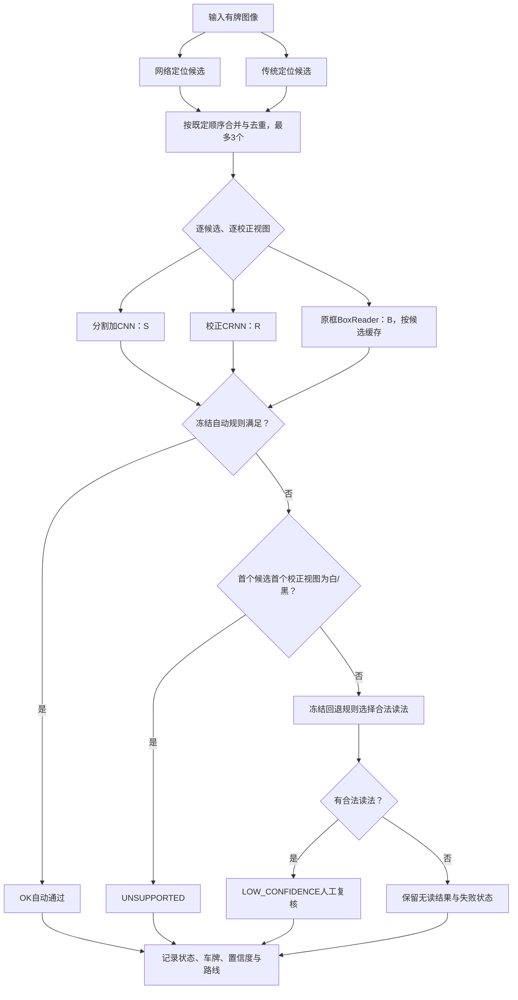

# 第 3 章　三路仲裁与评测

本章说明分割识别（S）、校正后整牌识别（R）与原框直接识别（B）的组合流程，以及固定开发集上的评测口径。候选来自网络检测器与传统定位器融合后的有序列表；各路线保持同候选及校正视图身份。数值来自第十三批已复核的冻结报告，具体实现合同见集成规格v2。

## 3.1 三路仲裁流程

定位器按配置产生候选。候选合并保留网络候选优先顺序，传统定位候选用于补充；按交并比去重后最多保留三个。对每个候选按既定校正顺序尝试读取：S沿用现有 `_rank` 排序与版式尝试，并在首个分割状态为 OK 的结果处停止；R在校正图上识别整牌，B在原候选框上读取一次并缓存。不同候选之间不合并投票。自动规则先检查同一候选、同一校正图上的路线一致与置信度条件；未自动通过时，先应用白牌、黑牌等特殊颜色业务门禁，再按冻结的回退规则返回人工复核结果，无法形成合法读法时保留失败状态。自动 OK 沿用现有流水线的业务语义。

遍历次序、相同置信度时的稳定优先规则、阈值精确值，以及候选融合在新检测器下的来源，均以集成规格 v2 为实现合同。任何实现应输出逐图 `path/status/plate/confidence/route`，并在相同输入上与冻结期望逐项比对；不得把回退输出提升为自动 OK。

## 3.2 配置与门槛

三路策略由显式配置控制，避免阈值散落在代码中。集成至少需要登记：检测器权重路径与加载器、BoxReader 权重路径与加载器、框读 padding、三路配对和单路置信度门槛、自动路线开关、子组补救开关、回退策略标识，以及合法车牌格式约束。检测器替换须记录其权重哈希和实际融合候选来源；BoxReader 的 padding 由该权重登记值决定。S、R、B的合法读法均遵守当前解码器的7/8位车牌格式与有限置信度范围。

第十三批对照为旧定位加 box_reader_v2，主组合为 plate_det_v1 加 box_reader_v2。主自动规则011，`three_route_agree_min=0.7329292297363281`、`box_solo_min=0.9414944052696228`；fit回退T20_A：首候选预测四角点角度≥20度选A，否则选M，缺角按M。省份字支持门禁的预设五组在fit均≥99%，未触发。fit冻结原策略及固定p2反事实后，才报告hold/full；全量反事实少通过18张且错误自动通过未减少，因此不采用。主自动精度val 981/983 (99.7965%)、devhard 1781/1790 (99.4972%)；devhard未达99.5%，不满足双集合门槛，不能作为达标默认推荐。遍历、平分等细节见[三路仲裁集成规格](../research/03-三路仲裁集成规格.md)第十三批小节；box_reader_v1阈值不适用于v2。

## 3.3 数据划分与保护名单

模型与规则开发使用固定 `val1000_v1`（1000张）及 `devhard_v1`（2100张，七个难例子集各300张），按内容安全的固定种子划分 fit/hold。重复原图按SHA256归并至同一半区，必要时仅调整单例以恢复各分层计数；两半之间必须满足原图内容零交叉。策略只在fit上选择一次，hold只报告，不用于加规则、改阈值或重选。完整开发集统计用于描述最终固定策略，不代表独立冻结测试集结果。

训练池、样本生成及独立模型训练/调参须排除五份保护名单中的路径与图像内容：共享冻结测试清单 `testset_manifest_v1.csv`、金样例 `golden_manifest.csv`、固定难例 `devhard_v1.csv`、固定验证集 `val1000_v1.csv`、不可解码清单 `undecodable.csv`。排除按规范化路径及原图SHA256执行；复制到新路径的同字节图仍视为已保护。清单版本、SHA256和实际排除计数应写入数据审计材料。第十三批派工明确授权在固定 val/devhard 上进行本批仲裁规则 fit/hold；因此这两份清单仅用于指定的开发评测及内容隔离规则选择，不用于训练池、独立模型调参或冒充独立测试集。冻结G2测试清单与20张金样例只供各自正式验收，不参与本批选择或推理。

G2的clear样本中，base的120张从其官方val一次性留出并固定到共享测试清单；这120张不进入日常val抽样、训练字符样本或阈值/模型调参。本批仅按派工使用固定val1000与devhard开发清单，没有使用或评测该冻结G2样本。

## 3.4 指标口径与G2边界

开发集整牌准确率按集合固定分母计算：完整预测文本与真值完全相同的图数除以该集合图数；漏检、分割失败、空读及格式错误均计错。自动通过率为 `OK数/有牌总数`；自动通过精度为 `OK且整牌正确数/OK数`，没有OK时记为N/A。自动通过精度只在自动接受子集内计算，不能替代整牌准确率。另按 `base`、绿牌、七种 devhard 子集、最暗档（亮度≤19）、`tilt+rotate` 和自动通过子组分别报告分子、分母与比例。省份首字准确率按真值省份字符与预测首字完全相同计；各路线及最终仲裁的省份表现分开列示。

正式G2口径见《车牌识别》详细设计§3.12—3.13：clear/night/tilt/dirty主集至少300张，local与无牌np另报；漏检、分割失败计错。目标为清晰≥95%，夜间、倾斜、污损各≥85%。字符准确率按逐位相等字符数/真值与预测长度较大者之和计算；Top-3 IoU≥0.5定位召回独立测量。开发集折算不等于冻结G2结果。派工折算组成是清晰base120+green30、夜间dark、倾斜tilt35+rotate15、污损weather。

## 3.5 开发集结果记录

下表为固定开发集最终业务投影后的复核结果。准确率保留分子和固定分母；自动精度同时给出自动接受张数。拟合半与保留半以内容分组隔离，样本SHA交叉为0；主分析与对照各自的独立审计均对3100条逐图输出核对，差异为0。

| 组合 | val | 绿牌 | devhard | 最暗档 | tilt+rotate | 自动策略 / 回退 |
|---|---:|---:|---:|---:|---:|---|
| 主：plate_det_v1 + box_reader_v2 | 990/1000 (99.0%) | 491/500 (98.2%) | 2004/2100 (95.43%) | 49/51 (96.08%) | 586/600 (97.67%) | 011 / T20_A |
| 对照：旧定位 + box_reader_v2 | 979/1000 (97.9%) | 483/500 (96.6%) | 1786/2100 (85.05%) | 47/51 (92.16%) | 527/600 (87.83%) | p2-safe-111 / M |

主组合自动精度为val 981/983 (99.7965%)、devhard 1781/1790 (99.4972%)，难例差0.0028个百分点未达99.5%，不能四舍五入作达标。对照为val 958/962 (99.5842%)、devhard 1456/1463 (99.5215%)，两集均达到99.5%。对照fit中fn自动精度107/109 (98.1651%)触发预先定义的p2补救门禁，门禁策略fit覆盖代价36张，最终全量自动覆盖较未门禁规则少75张；策略选择只用fit，未用hold重选。

| 自动通过子组 | 主组合正确/通过 | 对照正确/通过 |
|---|---:|---:|
| 最暗档 | 41/41 (100%) | 30/30 (100%) |
| 绿牌 | 483/484 (99.79%) | 465/468 (99.36%) |
| fn | 262/263 (99.62%) | 208/210 (99.05%) |
| challenge | 230/232 (99.14%) | 187/189 (98.94%) |
| 非皖 | 225/228 (98.68%) | 184/186 (98.92%) |

主组合非皖自动精度低于99%；fit未触发省份门禁，不据hold/full追加。按派工组成折算，主组合清晰99.48%、夜间96.08%、倾斜97.40%、污损99.33%；对照分别98.68%、92.16%、86.83%、99.33%。这些仅为开发集折算。

逐图期望及省份/错误分桶明细保存在第十三批报告附件；本章只保留足以说明组合差异、子组风险与G2口径的汇总。架构实现应按逐图压缩JSONL及其哈希、数据分半身份、权重哈希和执行代码版本复核。

## 3.6 流水线实现（第十四批）

三路已作为显式配置分支接入 `PlateRecognizer`。启动时按配置加载字符分类器、检测器、校正整牌读牌器和可选框读模型；版本字符串追加框读权重版本。第十四批实装时默认配置为 `agree`，框读路径为空，新增键不改变旧行为。`config/three_route_v2.toml` 为验收用覆盖文件，模型路径和阈值全部从配置读取，便于后续替换模型。

每帧先预处理与传统定位，再将网络候选合并为有序候选。每候选用官方 `crop_box` 读取一次原框，pad从框读权重的 `box_pad` 读取，结果在该候选各校正视图间复用。逐视图完成S/R后，按S/R、S/B、R/B配对及S/R单路门槛调用无图像依赖的纯函数；所有视图后才考察B单路。首次自动通过立即返回，后续候选不再推理。未自动通过时，采集的读法交纯函数执行A/M/L、T20_A和业务状态投影。输入错误、异常兜底与原状态码保持；路由和候选/视图索引仅作为结果对象的验收诊断属性，不修改原公开JSON字段。

| 配置键 | 第十四批默认值 | 三路配置值（第十五批默认） |
|---|---|---|
| runtime.box_reader_model_path | 空 | models/box_reader_v2.pt |
| runtime.corner_model_path（已有） | models/corner_net_v1.pt | models/plate_det_v1.pt |
| postprocess.arbitration（已有） | agree | three_route |
| three_route_agree_min_confidence | 1.0（未启用） | 0.7329292297363281 |
| three_route_box_solo_min_confidence | 1.0（未启用） | 0.9414944052696228 |
| three_route_legacy_sr_agreement | false | false |
| three_route_segment_solo / three_route_reader_solo | false / false | true / true |
| three_route_province_support_min_routes | 0 | 0 |
| nonok_fallback（已有） | agreement_then_reader | predicted_tilt_then_corrected |
| fallback_predicted_tilt_min_deg | 0.0（未启用） | 20.0 |

表中未带段名的键均属于postprocess；两条旧solo阈值仍复用已有键，旧agree阈值仅供L复放。置信度比较不加容差、不截断浮点；T20_A仅看候选0预测四角点，缺失/非有限角度走M。

第十四批真实流水线按val1000后devhard2100顺序，与第十三批冻结期望逐张核对3100张，status、plate、route及候选/视图索引差异0，confidence绝对误差不超过1e-7。默认配置改动前后各跑同一val1000，status、plate和confidence零容差比较差异0。新配置金样例为19/20；这些属于本批实装复核，不改变第十三批自动精度99.5%门槛未完全达成的事实。

G1使用冻结320路径清单的同序纯路径副本，不读真值；1280×720等比补边，预热5次、按原顺序循环计时100次，Torch2/OpenCV1。只计recognize墙钟，图片读取和补边不计。

| 配置 | 总P50 ms | 总P95 ms | 最大 ms | 框读P50/P95 ms |
|---|---:|---:|---:|---:|
| three_route_v2 | 64.37 | 80.46 | 117.37 | 4.45 / 6.83 |
| 默认agree | 42.92 | 63.82 | 120.06 | 未调用 |

两配置P95均低于G1的300ms目标；这是本机本次100调用结果，不能外推所有子组时延。完整分阶段P50/P95、资源与逐张记录见第十四批回执。G2仅备好一次性入口及清晰/夜间/倾斜/污损汇总，以3张非测试集图片冒烟；正式冻结集准确率未运行，须等省份模型配置确认和架构师通知。

### 第十五批：已设为默认（2026-10-28）

按用户本批决定，011 + T20_A三路新流程已设为默认；不传路径的PlateRecognizer.from_config()加载plate_det_v1、box_reader_v2及原char_cnn_v2/crnn_v2。第十四批留档配置three_route_v2.toml保持原样，旧agree流程改由config/legacy_agree_v1.toml显式复现；两者规则和完整浮点门槛未变。上表“第十四批默认值”为历史值，第三列为当前默认值。

本批重新实际运行：默认val1000+devhard2100对第十三批期望3100张六字段0差异（confidence≤1e-7）；legacy对第十四批旧默认val1000的status/plate/confidence零容差0差异。默认金样例19/20，原test_golden通过；全量pytest一次1052 passed、3 subtests passed，G7 lpr覆盖3048/3236=94.19%。

默认G1沿用冻结320条纯路径清单，不读真值，1280×720、预热5、计时100、Torch2：P50 54.128150 ms、P95 70.320935 ms、最大105.999500 ms。各阶段P50/P95如下，不能相加为总P95：

| 阶段 | P50 ms | P95 ms |
| --- | ---: | ---: |
| box_crop | 0.019250 | 0.035480 |
| box_reader | 3.593800 | 5.194315 |
| corner | 23.012650 | 26.012610 |
| locate | 8.128150 | 12.153395 |
| postprocess | 0.238050 | 0.297165 |
| preprocess | 5.364550 | 5.875810 |
| reader | 3.254000 | 6.793725 |
| recognize | 3.469500 | 4.363005 |
| rectify | 3.477900 | 5.699760 |
| segment | 2.081600 | 10.786175 |

G2入口现默认读取default.toml，本批只验证准备模式，未执行正式冻结集准确率；未来省份模型与正式评测仍需后续派工。既有hard自动精度99.4972067%的风险不因切默认消失。资源与磁盘预算偏差、保留临时目录及完整证据见第十五批回执。

### 第十六批：检测器输入尺寸与摄像头口径（2026-10-28）

runtime新增 `detector_input_size`：StrictInt，0沿用checkpoint输入尺寸（当前256），非零接受128—1024且为32倍数；默认0。非零只适用于plate_det，沿用已校验的权重、版本及检测阈值；旧corner/关闭检测器时显式指定非零值报ConfigError。default.toml只增加该键，原默认值、模型、三路规则与阈值不变。冻结键测试只同步此键。

默认无路径配置val1000+devhard2100对第十三批期望：3100张，六字段0差异（confidence≤1e-7）。相关测试151 passed、15 subtests passed，另8项视频线程测试通过。bench_video增加可选--decoder-threads，在此Windows环境显式传1以限制FFmpeg解码；省略参数保持旧行为。以下各尺寸原图各3100张；摄像头为固定种子20261028分层抽样600张，各倍率各600：base/green各97，其余七个devhard子集各58。复用02的camera_canvas，把原图按1280×720适配比例乘0.6/0.8/1.0后居中补边。只传整帧给流水线，不传真值。开发清单与冻结320图路径/内容交叉0；没有运行冻结G2准确率。

| 检测输入 | 原图清晰 | 原图夜间 | 原图倾斜 | 原图污损 | val自动精度 | hard自动精度 | 摄像头0.6整牌 | 摄像头0.8整牌 | 摄像头1.0整牌 | G1 P95 ms | 三条件通过(1/0) |
| --- | --- | --- | --- | --- | --- | --- | --- | --- | --- | --- | --- |
| 256 | 99.4800% | 96.0784% | 97.4000% | 99.3333% | 99.7965% | 99.4972% | 57.0000% | 78.0000% | 91.5000% | 134.983555 | 0 |
| 384 | 99.3600% | 96.0784% | 97.2000% | 99.3333% | 99.5885% | 99.1549% | 79.5000% | 93.0000% | 97.0000% | 86.788275 | 1 |
| 512 | 98.7600% | 98.0392% | 97.6333% | 99.3333% | 99.2708% | 99.2507% | 92.5000% | 96.8333% | 96.8333% | 204.501335 | 1 |

预先固定条件为原图四组分别下降≤1个百分点、摄像头1.0整牌≥95%、G1 P95≤300ms，同时满足尺寸：384、512。原图折算沿用§3.4组成；摄像头数字为整条流水线整牌正确率，自动精度另列。没有重选阈值或改变默认0；尺寸决策留给架构师和用户。

G1每尺寸一次，同第十五批320条纯path清单（不读真值）、1280×720、warmup5/n100/Torch2，排除读图与补边：

| 尺寸 | 总P50 ms | 总P95 ms | 总最大 ms | corner P50 ms | corner P95 ms | corner最大 ms |
| --- | --- | --- | --- | --- | --- | --- |
| 256 | 61.573500 | 134.983555 | 3073.827300 | 25.445750 | 55.067415 | 2872.211100 |
| 384 | 78.946500 | 86.788275 | 101.909800 | 48.664700 | 52.102920 | 56.931400 |
| 512 | 175.255700 | 204.501335 | 276.749400 | 129.445250 | 148.426545 | 171.033500 |

G3预演用60张val图各保持1秒，生成60秒/1280×720/25fps视频（8,540,924B）。默认配置5fps抽样，显式FFmpeg解码线程1，视频进程限制4个逻辑处理器，解码1500帧、识别300帧，墙钟36.812234s，端到端40.747323fps（门槛15，判定1）。这是合成图切换的工具/速度预演；正式G3仍需真实停车场视频。

改对/改错全量清单、代表样例、各尺度自动精度与NO_PLATE、六字段差异、资源和保留目录见第十六批回执。默认hard自动精度99.4972067%未达到99.5%的事实不变，不能以本批尺寸实验代替后续模型/阈值验证。

### 第十七批：省份模型与384成为新默认（2026-10-28）

本节更新当前默认；以上各批数字与配置描述为各自时点记录。采用C1：char_cnn_v2、crnn_v4、box_reader_v3、plate_det_v1，detector_input_size=384；011 + T20_A不变。C1满足本批两全集自动精度与四组折算准入，因此不评C2；char_cnn_v3不采用。default.toml仅改2个模型路径、检测尺寸、4个门槛，键集合不变。旧默认留档config/three_route_v2_det256.toml仅写7个差异值，加载后完整配置等于切换前默认。

沿用十三批同字节隔离的fit/hold（每半val500/hard1050），选法在新评分前写定，四轴精确搜索最大化fit接受数且两组非空精度≥99.5%。静态Config约束补充也在评分前冻结：agree/B轴上限1，S/R保留nextafter(1,+inf)关闭哨兵。完整搜索352377节点，frontier=0、覆盖gap=0；初选1380/1550。全集hard初选1782/1792=99.441964%未达标，按预注册agree→B→S→R循环逐一升下一个fit边界，538步后首次两全集达标（档数135/135/134/134），接受2763→2671，少92张。规则族/回退不再选择。

| 参数 | 新默认完整精度 |
|---|---|
| three_route_agree_min_confidence | 0.7233636975288391 |
| three_route_box_solo_min_confidence | 0.9802792072296143 |
| solo_min_confidence_segment | 0.9719608426094055 |
| solo_min_confidence_reader | 0.991486668586731 |

| 原图指标 | 旧默认 | 新默认 |
|---|---|
| clear组成折算 | 99.480000% | 99.240000% |
| night组成折算 | 96.078431% | 100.000000% |
| tilt组成折算 | 97.400000% | 96.600000% |
| dirty组成折算 | 99.333333% | 99.666667% |
| val整牌正确/总数 | 990/1000 | 984/1000 |
| val自动正确/接受 | 981/983（99.796541%） | 962/966（99.585921%） |
| devhard整牌正确/总数 | 2004/2100 | 1989/2100 |
| devhard自动正确/接受 | 1781/1790（99.497207%） | 1697/1705（99.530792%） |

新旧逐张改对43、改错64，整牌2994→2973（净-21）；自动接受2773→2671（相对旧默认-102）。旧结果复用十六批实测并核对完整旧配置和代码/模型SHA；新结果从trace生成不含真值的3100行期望，再用PlateRecognizer.from_config()无参数真实推理六字段0差异（confidence≤1e-7，阈值比较无容差）。
全集被本批明确用作开发准入，不能称独立测试；收紧后fit val484/485、hard855/858，hold val478/481=99.376299%、hard842/847=99.409681%，hold均未达99.5%。绿牌、challenge及省份面板也不保证99.5%，不能以全集达标抹去这些风险。

系统省份面板新旧各完整运行一次：真实486张原全帧；合成930张=31省×30，复用01每行seed和replace_province的原全帧像素，GT只用于合成几何/评分，流水线自己检测裁片。该面板已用于模型训练选择，不是盲测；以下是系统指标，区别于01孤立路线GT裁片数字。

| 面板/默认 | 整牌正确/N | 省字正确/N | 输出皖/非皖错皖 | 自动正确/接受 |
|---|---|---|---|---|
| province_holdout/旧 | 470/486 | 470/486 | 6/6 | 451/453（99.558499%） |
| province_holdout/新 | 474/486 | 474/486 | 7/7 | 456/460（99.130435%） |
| synth_eval/旧 | 342/930 | 350/930 | 491/465 | 221/506（43.675889%） |
| synth_eval/新 | 769/930 | 792/930 | 71/43 | 543/554（98.014440%） |

摄像头复用十六批同600图同几何：base/green各97、难例七组各58，1280×720适配后乘倍率并补边；新默认整条流水线各600张。

| 倍率 | 整牌正确/600 | 自动正确/接受 |
|---|---|---|
| 0.6 | 481/600（80.166667%） | 417/419（99.522673%） |
| 0.8 | 552/600（92.000000%） | 500/502（99.601594%） |
| 1.0 | 581/600（96.833333%） | 524/526（99.619772%） |

G1同十六批320条纯path清单、不读真值、1280×720、warmup5/n100、Torch2/OpenCV1；计recognize墙钟，不含读取/补边。新默认P50 88.902400ms、P95 105.313520ms、最大147.845600ms。本轮只计时一次，不外推其他硬件。
默认test_golden 20/20（原门槛13不改），在唯一一次全量pytest内观测，无重复推理。G7同次产生3081/3259行＝94.538202%，门槛60%。完整pytest结果、资源/新增磁盘、默认及历史配置身份见第十七批回执。

frozen_once已按新默认重新准备，prepared=true、inference_run=false，没有消费正式marker。正式测试准确率本批未运行，唯一正式命令列在回执末尾，等待架构师单独授权。旧legacy_agree_v1.toml和three_route_v2.toml是局部override，会继承当前未覆盖字段；旧默认复现实验应使用本批three_route_v2_det256.toml。

证据：[第十七批回执](D:/keshe2/workers/03/algorithm/out/receipts/第十七批.md)，含全部选参步骤、逐张输出、逐省分母及失败/风险说明。
