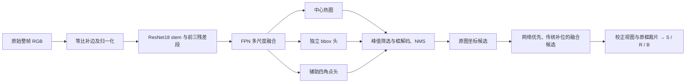

# 第三章　车牌定位检测器

本素材对应当前默认 `plate_det_v1`，供《详细设计》3.5、3.10及图5引用。当前实际流程为网络检测与传统定位融合，再送分割CNN、校正CRNN和原框BoxReader，最终采用011 + T20_A；不是单独检测框即完成车牌识别（来源：`algorithm/config/default.toml`、积分板首条commit `adcacce`、正文3.3）。旧双路流程仅显式使用 `algorithm/config/legacy_agree_v1.toml`。

## 3.1 结构、输入与输出

骨干为通用ImageNet预训练ResNet18的stem和layer1—layer3，输出经stride 8/16/32、64通道FPN自顶向下融合，连接中心热图、独立bbox、辅助角点三个头；共2,829,709参数（来源：本工位第十一批回执“模型与结构”；实现 `algorithm/lpr/plate_det.py`）。

v1训练输入288×288，当前默认推理256×256；最多取40个热图峰，分数阈值0.25，检测器内部框NMS IoU为0.5，最多输出3个候选（来源：本工位第十一批回执及 `plate_det.py:PlateDetector/decode_predictions`）。整帧BGR在内部转RGB并按ImageNet均值／标准差归一化；输出bbox、LT/RT/RB/LB角点、score、source，坐标逆变换至原图。bbox独立回归中心偏移和log宽高，不从角点包围盒生成；角点几何无效时用有效bbox四角回退，仍保留框候选。

当前流水线先取得传统定位候选，再运行网络检测；`_merge_candidates`按网络在前、传统在后顺序补位，IoU≥0.5去重并最多保留3个（来源：`pipeline.py:_run/_merge_candidates`、默认runtime配置）。这不是按两类分数全局排序，也不是仅网络无候选时才执行传统定位。网络在原图检测后按bbox中心过滤ROI，传统工作图保留缩放／offset映射。正文与图5均保留这一实际行为。

## 3.2 损失与标注

中心热图使用按正目标归一化的Gaussian focal loss。bbox分支为offset SmoothL1（β=0.1）、0.5×logWH SmoothL1（β=0.2）和3×(1−GIoU)；辅助角点为0.5×SmoothL1（β=0.05）（来源：`algorithm/lpr_tools/train_det.py:detector_loss`及本工位第十一批回执）。bbox与四角是独立监督目标，不强制框严格包住四角。NP与框外背景仅监督负热图，不给框／角点假标签。

## 3.3 数据隔离与训练量

v1使用213,043个路径／内容SHA唯一原图，包含NP2,400；NP排除保护来源后按seed42划train2,400、val601，另隔离hard2,100（来源：本工位第十一批回执“训练数据”及数据审计）。训练按路径和内容排除testset、golden、devhard、val1000、undecodable五名单，框外背景继续作负样本；不改共享索引，不将索引对未覆盖子集的默认test标签当作NP官方测试划分。

v1完成40个全池epoch、8,521,720次池曝光（来源：本工位第十一批回执及 `algorithm/out/eleventh` 覆盖记录）。训练使用AMP、AdamW、余弦学习率及梯度裁剪，前期冻结stem/layer1，低内存阶段进一步冻结layer2。逐轮覆盖、断点和模型SHA见该回执，不能把抽样或部分轮次写成完整epoch。新读牌模型的省份均衡与首字替换属于识别训练，不改变此检测器训练身份。

## 3.4 开发定位结果与系统结果边界

以下是v1检测框的Top-1/Top-3 IoU≥0.7，与字符整牌率不同；角点误差只在bbox IoU≥0.5匹配候选上统计（来源：本工位第十一批回执及 `algorithm/out/eleventh/devhard-report.json`、`val1000-report.json`）。

| 开发集 | Top-1 / Top-3命中 | 角点均误差px | 来源 |
|---|---:|---:|---|
| devhard | 2090/2100 / 2091/2100 | 5.999 | 第十一批回执；devhard-report.json |
| val1000 | 988/1000 / 988/1000 | 5.562 | 第十一批回执；val1000-report.json |

默认三路的开发整牌val为990/1000、devhard2004/2100，自动通过精度分别981/983和1781/1790（来源：积分板commit `adcacce`；`ch3-仲裁与评测.md` 3.5）。难例99.4972067%仍低于99.5%目标、差一张（同来源）；默认已启用不等于门槛全部通过。上述开发清单不是冻结G2测试集；正式测试准确率：报告阶段填写。

## 3.5 CPU时延、尺度与后续风险

当前默认整流水线G1 P95为70.3ms，目标CPU1280×720、P95≤300ms（来源：积分板首行commit `adcacce`；开发文档13.2）。时间基准预热5次、计时100次，不含读图与外部补边（来源：`ch3-仲裁与评测.md` 第十五批补记）。检测、透视校正、三路识别和仲裁均在该整帧范围内；不能把单次detect时延当作G1。

摄像头合成尺度实验中，v1默认256输入在0.6/0.8档Top-1 IoU≥0.7召回为10.81%/59.05%（来源：本工位第十二批回执，commit `bf32afc`）。v2曾从自有v1继续15完整全池轮；仅推理提高到512后，四个要求尺度最低98.05%，但默认256下仍有未达档（同来源）。这些是独立hard、GT锚点合成裁窗的诊断，不是当前默认三路或真实停车场实拍验收；本批不改变权重、默认输入或运行代码。

第十二批建议取消常规传统合并及“无候选必兜底”，依据是独立正集召回无增益及NP候选拒绝被破坏（来源：本工位第十二批回执“传统定位去留”）。建议尚未由当前默认实施；候选误检不等同于输出错误牌号，集成方仍需另测端到端NP及本地陕牌。图5必须继续呈现实际融合，不能先画成建议中的纯网络链。

材料来源：`algorithm/out/receipts/第十一批.md`、`第十二批.md`（本工位）；`algorithm/config/default.toml`；`docs/design/ch3-仲裁与评测.md`；积分板最上数据行commit `adcacce`。主正文为 `docs/design/03-车牌识别.md`，当前图5源文件为 `docs/img/src/pipeline.drawio`。本批只整理文档，未运行模型或评测。
