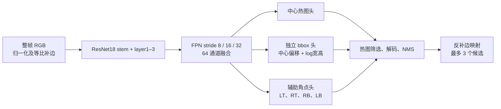

# 第三章　车牌定位检测器

## 3.1 网络、输入与输出

定位器对整帧 RGB 输出最多三个候选，每个含独立 bbox、四角点、分数和来源。骨干为 ImageNet 预训练 ResNet18 的 stem/layer1–3；stride 8/16/32 特征经 64 通道 FPN 自顶向下融合，接中心、bbox、角点头。共 2,829,709 个参数。

v1/v2 训练输入分别为 288/256，部署检测输入为 256。推理取至多 40 个热图峰，以阈值 0.25 解码、IoU 0.5 NMS，映射回原图。框头独立回归中心偏移和 log 宽高，**不由角点外接生成**；角点缺失或几何无效时用有效 bbox 矩形回退。无牌图仅监督热图负类。定位输出不代表字符或端到端识别准确率。

## 3.2 监督损失

中心热图用按正目标数归一的 CenterNet Gaussian focal loss。框分支在正中心计算 offset SmoothL1（β=0.1）、0.5×logWH SmoothL1（β=0.2）及 3×(1−GIoU)；辅助角点使用 0.5×SmoothL1（β=0.05）。框标注与四角标注独立保留；框与四角是不同监督目标，不强制框严格包住四角。负样本仅贡献热图损失。

## 3.3 数据隔离与训练

v1 父模型训练池为 213,043 个路径和 SHA 唯一图像（CCPD 子集及 2,400 NP）；另抽训练图 bbox 外背景块。NP 按 seed 42 分为 train 2,400、val 601。训练排除 testset、golden、devhard、val1000、undecodable 五名单，并隔离 hard 2,100 与 NP-val；未改共享索引。独立 val reserve 按 seed 20261028 从共享 val split 取 base 750、green 250，按路径和 SHA 与名单、训练池及 holdout 隔离。

v1 完成全池 40 epoch（8,521,720 次图像曝光），使用 AMP/AdamW、余弦 LR、梯度裁剪，阶段性冻结 stem/layer1、低内存时另冻 layer2。v2 从 v1 初始化、重建 optimizer/RNG，完成全池 15 epoch（3,195,645 次曝光；有效训练约 13,973 秒）。增强 80% 随机取六档相机尺度变换至 1280×720 且完整保留框/角点，20% 保持原域，并沿用亮度和几何增强。部署 epoch15 权重与完整 checkpoint 已核验状态一致。

## 3.4 冻结定位结果

下表为 Top-1/Top-3 框 IoU≥0.7 命中数。v1 数字来自第十一批冻结报告，v2 来自第十二批冻结报告；方法键沿用旧名 `plate_det_v1`，但 v2 文件实际测的是冻结的 `plate_det_v2`。角点误差以匹配框 IoU≥0.5 的候选计算，单位 px。

| 冻结集合 | v1 Top-1 / Top-3 | v2 Top-1 / Top-3 | v1 / v2 角点误差 |
|---|---:|---:|---:|
| devhard 2,100 | 2,090 / 2,091 | 2,086 / 2,088 | 5.999 / 6.319 |
| val1000 1,000 | 988 / 988 | 992 / 992 | 5.562 / 5.911 |

epoch 15 是候选中 required-scale 评分更高者，但默认 256 输入的 hard scale 0.6/0.8 仅 83.29%/93.43%，均低于 95%，原画幅冻结成绩不代表小目标尺度鲁棒性达标。NP 默认阈值 0.25 下，v1 误检 68/601，v2 为 75/601（12.48%），v2 更差。

## 3.5 尺度、速度与接入

默认 256 下 hard scale .6/.8 召回为 v1 10.81%/59.05%、v2 83.29%/93.43%。较大输入能明显缓解小目标漏检，但非唯一因素：v1/512 的 .6 仍为 91.48%；v2/384 的 .6 为 1,992/2,100（94.86%，差 3 张达95%）。v2/512 六档为 92.24/98.05/99.14/99.10/98.29/97.14%，required 四档均过95%，但总体不单调。这是诊断消融，不改变默认256。

| 模型 / 输入 | scale .6 / .8 Top-1 | scale 1.0 detect P50 / P95 ms |
|---|---:|---:|
| v1 / 256 | 10.81% / 59.05% | 31.21 / 47.35 |
| v1 / 384 | 68.33% / 91.95% | 80.27 / 188.51 |
| v1 / 512 | 91.48% / 98.81% | 130.00 / 243.91 |
| v2 / 256 | 83.29% / 93.43% | 33.84 / 52.21 |
| v2 / 384 | 94.86% / 98.14% | 56.75 / 83.59 |
| v2 / 512 | 98.05% / 99.14% | 97.98 / 139.20 |

detect 时延同为 hard 2,100、CPU 双线程、scale1；384/512 六档 pooled 数见回执。跨时段主机负载未控制，同尺寸时差不能全归因权重。整帧流水线（预热5、计时100，不含读图/外部 letterbox）v1/v2 P50/P95/max 为 65.09/100.53/160.95 与 78.25/124.61/214.46 ms；金样例均19/20。不是识别准确率指标。

真实 loader 阈值 .25 下，hard detector/merge 均 Top1/3 2,085/2,088，均候选 1.003→2.997；val 均为 982/982、1.000→2.999。classic 在 NP 601/601 均产候选；v1 detector 误检68/601，阈值 .60 为33/601。无候选 fallback 在多数 NP 图触发且仍误检601/601，因此建议去掉 merge 且不启用 fallback。.60 是 v1 独立 val 的运行建议；模型默认仍为 .25。

来源：`algorithm/out/eleventh` 冻结报告及 `algorithm/out/twelfth` 的尺度、冻结、延时、task2、NP JSON。实现见 `algorithm/lpr/plate_det.py`、`algorithm/lpr_tools/train_det.py`。
