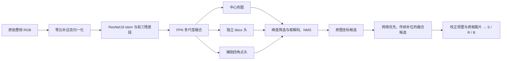

# 第三章　车牌定位检测器

本素材对应最终默认 `plate_det_v1@384 + char_cnn_v2 + crnn_v4 + box_reader_v3`，供《详细设计》3.5、3.10引用。实际流程为网络检测与传统定位融合，再送 S/R/B，最终采用011 + T20_A；默认四阈值来自03第十七批，精确值与选法见正文3.9（来源：`algorithm/config/default.toml`、积分板开发最新行 `a0b0002`、[C17] §1/§2）。正式G2已完成，不能再标作待测。

## 3.1 结构、输入与输出

骨干为通用ImageNet预训练ResNet18的stem和layer1—layer3，输出经stride 8/16/32、64通道FPN自顶向下融合，连接中心热图、独立bbox、辅助角点三个头；共2,829,709参数（来源：本工位第十一批回执“模型与结构”；实现 `algorithm/lpr/plate_det.py`）。

v1训练输入288×288，当前默认推理384×384（来源：本工位第十一批回执、`default.toml`的`runtime.detector_input_size`、[C17] §1）；最多取40个热图峰，分数阈值0.25，检测器内部框NMS IoU为0.5，最多输出3个候选（来源：本工位第十一批回执及 `plate_det.py:PlateDetector/decode_predictions`）。整帧BGR在内部转RGB并按ImageNet均值／标准差归一化；输出bbox、LT/RT/RB/LB角点、score、source，坐标逆变换至原图。bbox独立回归中心偏移和log宽高，不从角点包围盒生成；角点几何无效时用有效bbox四角回退，仍保留框候选。

当前流水线先取得传统定位候选，再运行网络检测；`_merge_candidates`按网络在前、传统在后顺序补位，IoU≥0.5去重并最多保留3个（来源：`pipeline.py:_run/_merge_candidates`、默认runtime配置）。这不是按两类分数全局排序，也不是仅网络无候选时才执行传统定位。网络在原图检测后按bbox中心过滤ROI，传统工作图保留缩放／offset映射。正文与图5均保留这一实际行为。

## 3.2 损失与标注

中心热图使用按正目标归一化的Gaussian focal loss。bbox分支为offset SmoothL1（β=0.1）、0.5×logWH SmoothL1（β=0.2）和3×(1−GIoU)；辅助角点为0.5×SmoothL1（β=0.05）（来源：`algorithm/lpr_tools/train_det.py:detector_loss`及本工位第十一批回执）。bbox与四角是独立监督目标，不强制框严格包住四角。NP与框外背景仅监督负热图，不给框／角点假标签。

## 3.3 数据隔离与训练量

v1使用213,043个路径／内容SHA唯一原图，包含NP2,400；NP排除保护来源后按seed42划train2,400、val601，另隔离hard2,100（来源：本工位第十一批回执“训练数据”及数据审计）。训练按路径和内容排除testset、golden、devhard、val1000、undecodable五名单，框外背景继续作负样本；不改共享索引，不将索引对未覆盖子集的默认test标签当作NP官方测试划分。

v1完成40个全池epoch、8,521,720次池曝光（来源：本工位第十一批回执及 `algorithm/out/eleventh` 覆盖记录）。训练使用AMP、AdamW、余弦学习率及梯度裁剪，前期冻结stem/layer1，低内存阶段进一步冻结layer2。逐轮覆盖、断点和模型SHA见该回执，不能把抽样或部分轮次写成完整epoch。新读牌模型的省份均衡与首字替换属于识别训练，不改变此检测器训练身份。

## 3.4 最终默认的系统结果与边界

检测框Top-1/Top-3 IoU命中与系统整牌正确率不同；历史独立检测结果集中列于3.6，不作为当前384三路结果。最终默认的开发val整牌984/1000、devhard1989/2100，自动精度分别962/966＝99.59%、1697/1705＝99.53%（来源：[C17] §2/§3、积分板最新行 `a0b0002`）。全集自动精度缺口已关闭，但检验那一半开发集val478/481＝99.376299%、devhard842/847＝99.409681%仍低于99.5%（来源：[C17] §2）；全集参与收紧，不能称独立测试。

冻结测试集正式G2为清晰148/150＝98.67%、夜间48/50＝96.00%、倾斜49/50＝98.00%、污损48/50＝96.00%，四组均达标；合计293/300＝97.67%，自动精度282/283＝99.65%（来源：[C18] §2、积分板“冻结测试集正式G2” commit `2b6d89a`）。只跑一次，跑完未调参，架构师独立重算一致；完整原表见正文3.13.3。本地组数量0，陕牌照片仍待用户提供 [C18]。

## 3.5 CPU时延、摄像头与目标选择风险

当前默认整流水线G1 P95为105.3ms，原值105.313520ms；CPU1280×720、预热5次、计时100次、Torch2/OpenCV1，不含读图与外部补边（来源：[C17] §6、g1.json）。目标P95≤300ms（来源：开发文档13.2）。G7为94.54%、金样例20/20，来源均为[C17] §6；单次detect时延不代替G1。

最终默认同600图摄像头模拟在0.6/0.8/1.0倍率整牌分别481/600、552/600、581/600，即80.166667%/92.000000%/96.833333%（来源：[C17] §5）。这是1280×720整帧的三路流水线，不是单独框召回；小车牌、曝光、运动模糊仍需真实摄像头联调。G3合成视频预演40.7fps，正式五分钟视频待提供（来源：`ch3-仲裁与评测.md`第十六批补记，原值40.747323fps）；此前预演不等于最终默认正式G3验收。

多车牌选目标已出现实际错误：正式倾斜组唯一自动误通过图内有两辆车，主车牌浙B887TN未自动通过，系统退到第2个候选并正确读出旁车皖ALK353，返回OK／reader（来源：积分板 `2b6d89a`、[C18] §3序号223）。M3需核实摄像头取景及感兴趣区域是否覆盖目标车辆；读对旁车不等于识别了业务目标。本文只记录现象与联调影响，不声称已增加目标选择机制。

正式np附加组3/20非空读法、0次自动通过（来源：[C18] §2/§3）。M3按状态处理低置信或非法格式，不能把候选框或非空文本直接视为可放行结果。

## 3.6 演进与对照

v1权重原生推理尺寸256×256；第十一批的独立检测框结果为Top-1/Top-3 IoU≥0.7，角点误差只在bbox IoU≥0.5匹配候选上统计（来源：本工位第十一批回执及 `algorithm/out/eleventh/devhard-report.json`、`val1000-report.json`）：

| 历史开发集 | Top-1 / Top-3命中 | 角点均误差px | 来源 |
| --- | --- | --- | --- |
| devhard | 2090/2100 / 2091/2100 | 5.999 | 第十一批回执；devhard-report.json |
| val1000 | 988/1000 / 988/1000 | 5.562 | 第十一批回执；val1000-report.json |

旧三路默认 `adcacce` 的val990/1000、devhard2004/2100，自动精度981/983、1781/1790，G1 P95 70.3ms，均为历史积分板记录，不能覆盖3.4/3.5的新默认结果。该旧三路组合由 `algorithm/config/three_route_v2_det256.toml` 留档；更早双路的 `legacy_agree_v1.toml` 仅为局部覆盖，会继承当前未覆盖字段，不能保证单独加载即可复现（来源：[C17] §1/§8；正文3.10.6）。

第十二批GT锚点合成裁窗诊断中，v1@256在0.6/0.8档Top-1 IoU≥0.7召回10.81%/59.05%；v2从v1继续15完整轮，推理512后四个要求档最低98.05%，默认256仍有未达档（来源：本工位第十二批回执，commit `bf32afc`）。该独立hard诊断不等于当前384三路成绩，也不构成plate_det_v2进入默认的依据。

第十二批曾建议取消常规传统合并与“无候选必兜底”，依据为其独立正集及候选级NP诊断；当前默认仍有传统融合（来源：本工位第十二批回执“传统定位去留”、`pipeline.py:_merge_candidates`）。本批不修改运行时行为，也不把建议画成已实现能力。

材料来源：本工位 `algorithm/out/receipts/第十一批.md`、`第十二批.md`；`algorithm/config/default.toml`；`docs/design/ch3-仲裁与评测.md`；积分板开发 `a0b0002` 行与正式G2 `2b6d89a`。本素材[C17]为只读 `D:\keshe2\workers\03\algorithm\out\receipts\第十七批.md`（commit `cd3d7b7a96bffcef7fbef87e24a19caedf0c887d`）；[C18]为该工位第十八批回执（基线 `2a64ea4`，无提交）。主正文 `docs/design/03-车牌识别.md` 3.15.2提供完整出处索引。本批仅整理文档，未运行模型、评测或测试，未修改图5源文件及PNG。
