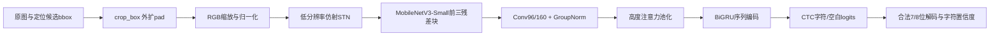
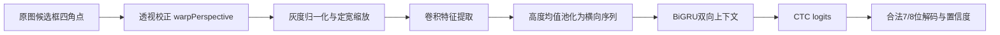
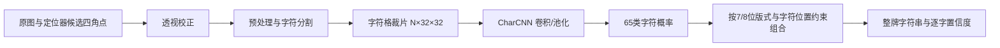

# 第 3 章识别模型：三路整牌读取设计素材

| 元信息 | 内容 |
| --- | --- |
| 文档用途 | 《M2车牌识别详细设计》第3章素材，供架构师合并 |
| 维护范围 | 三条识别路线、训练/评测边界和已复核开发集基线 |
| 当前基线 | box_reader_v2、crnn_v2、char_cnn_v2；第十二批三模型续训与结果待该批冻结后补录 |
| 运行边界 | 当前文档描述模型与离线对照；不表示新权重已接入默认流水线 |

## 3.1 识别器职责和协作输入

三种识别器针对同一车牌的不同表示提供读法：框直接读路线从定位器给出的原始矩形框直接识别，减少对角点校正的依赖；CRNN路线读取四角点透视校正后的整牌序列；分割+CNN路线先把整牌切为字符格，再逐字符分类并按版式规则组合。检测与识别分开训练，三路输出都保留候选身份和模型版本，供上层仲裁及离线追溯。

本章的“read”指一张已准备好的裁片进入识别模型后的推理，不含原图读取、定位、候选融合、透视变换和业务接口耗时。实际系统仍需以端到端G1基准测量整帧延迟。模型文件必须和manifest中的架构、字符表、输入尺寸、pad、SHA及训练数据记录一致；加载时校验元数据，不以文件名猜架构。

## 3.2 框直接读：STN + MobileNetV3前段 + BiGRU + CTC

输入是原图中的候选矩形框和其bbox；读取时按权重记录的`pad_x/pad_y`通过正式`crop_box`从原图截取，不用真值四角、不做外部透视校正。v2的输入为RGB宽×高192×64，ImageNet均值方差归一化，pad=(0.08,0.12)。仿射STN只看像素；训练时GT四角相对当前bbox裁片提供几何辅助监督，推理不接收GT。骨干继承本项目v1相同层的通用ImageNet初始化，不使用车牌专用外部权重；新STN与识别头随机初始化。特征序列由高度注意力压缩后输入单层双向GRU，CTC在横向时间步输出字符序列。

输入契约为BGR `uint8`原始crop，输出是解码字符串、每个输出字符置信度和整牌最小字符置信度；非法7/8位序列会按识别器契约拒绝。第十二批v3从v2继续训练，额外加入均衡省份首字样本和只用于训练的首字合成；具体轮数、选中epoch、温度、实际框评测与资源数字以本批最终回执冻结记录为准。

## 3.3 校正CRNN：透视归一化 + CNN + BiGRU + CTC

输入来自定位/校正路线的四角点及原图；先以透视变换生成水平整牌，再按字符数对应的标准尺寸裁片。当前CRNN的训练/推理图像为灰度，缩放到高40像素、宽160像素的输入张量；正式读取接口接受四角校正后的BGR 252×80（7位）或276×80（8位）裁片，模型内部灰度化、缩放并按[-1,1]归一化。CNN提取空间特征，沿高度自适应平均得到宽度序列，BiGRU产生上下文表示，线性层输出65类字符加CTC blank。无需字符框逐字标注，整牌字符串即可计算CTC损失。

CRNNv2为本地历史权重基线；第十二批crnn_v4从其权重续训，在安全GT四角校正裁片上加入省份均衡抽样和首字替换合成。训练仅用通过隔离审计的训练分区；固定val/devhard只作冻结后报告。模型的输入尺寸、温度与状态字典结构不得直接从box reader推断，工厂需按checkpoint的architecture/version校验。

## 3.4 分割 + CNN：字符格分类和规则解码

输入为透视校正后的BGR整牌及版式/颜色信息，字符分割模块输出`N×32×32 uint8`灰度字符图，N随7/8位布局而定。CharCNN内部为1→32→32→64→64→128卷积块，池化后展平，2048→256→65全连接分类；每个字符格输出65类概率。其后按省份、字母、数字/字母混合槽位限制与长度规则组成整牌，位置约束只能剔除非法类，不使用测试标签。

char_cnn_v3用于补省份字符类别，同时要求原有其余字符类别不退步。工厂/模型需兼容旧checkpoint；实现时需明确它是保持65类统一分类头并续训，还是增加省份专用分支并保留原头，不能只发布31类权重替代65类部署契约。第十二批只以真实外省首字裁片和字体渲染合成补足；图像合成不写入运行时包。训练增强不可覆盖验证真值，模型尺寸、每字符耗时和整牌字符准确率待冻结评测后填写。

## 3.5 训练样本、保护规则与省份均衡

训练数据继承第十一批安全CCPD索引和只读扩框裁片缓存。任何训练/合成底图都必须先按规范路径及内容SHA排除testset、golden、devhard、val1000、undecodable五份保护名单，并排除跨名单别名、重复字节和本批省份留出；不能通过更换裁片路径重新纳入同一原图。共享缓存只读，不生成新的全量图片缓存或外部数据集。温度拟合和选模使用派单指定调参资料，不能使用最终测试集决定训练步骤。

第十二批省份留出按派单固定种子逐省抽取`min(20, floor(该省可用安全候选数×30%))`张，按源图SHA隔离；不足5张的省份只报告合成评测，不将单张留出结果过度解释。真实外省样本在第十一批既有难例组配额内按首字符省份再分层，采样器需写入每省最小/最大draw和每epoch真实unique覆盖，避免单一“省份平衡”改变tilt、green、dark等已有子集分布。第十一批训练与回归指标中的组重叠，按既有主组规则统计后仍须单列省份结果。

首字替换只作用于训练样本：从原始真实裁片按GT四角和槽位布局确定首字格，遮除原字后渲染目标省份字并同步更新字符串标签；之后对整牌统一施加色底/字色匹配、轻度透视、模糊和噪声。31个省份的生成数量按确定种子控制。每个随机种子、字体文件本机路径、参数和被替换源SHA写入数据审计，字体本身不入库。合成占比不得只看训练loss决定，应同时检查真实省份留出与逐省固定合成评测；合成图全程在线生成，不落大量图片缓存。字体/图像权利只允许在项目授权范围内使用。

## 3.6 已复核开发集结果与测量边界

下表是第十一批及架构师第十二批在旧模型上的已复核基线，作用是判断第十二批更新是否回归。它们的模型、定位器、回退规则及业务门禁不同，不能拼成一个排行榜。第十二批三个新checkpoint冻结后，应在表后新增同口径行，并对非皖261张、逐省留出与合成31省×30张单列首字准确、整牌准确及错为“皖”数量。

| 数据/路线/口径 | 整牌结果 | 关键子集结果 | 来源与限定 |
|---|---:|---|---|
| box_reader_v2，val1000实际Top-3候选合法读法 | 974/1000（97.40%） | green 478/500（95.60%） | 第十一批冻结评测；候选为corner_net_v1+传统定位，read CPU2线程mean 4.1786ms、P95 5.6259ms；非整帧时延 |
| box_reader_v2，devhard_v1实际Top-3 | 1792/2100（85.33%） | 最暗48/51（94.12%）；tilt+rotate 527/600（87.83%） | 第十一批固定开发集，取合法读法最高最小字符置信度 |
| box_reader_v2，safe GT tune | 2316/2400（96.50%） | tilt 293/300（97.67%）；8位green 285/300（95.00%） | 参与选轮，不是盲测 |
| 三路011+D0_M（v1读牌器+架构师推荐plate_det_v1配置），val/devhard | val 960/1000（96.00%）；hard 1605/2100（76.43%） | green 465/500（93.00%）；dark 40/51（78.43%）；tilt+rotate 481/600（80.17%） | 03第十二批旧模型冻结trace回放；自动通过2053，val 904/908=99.56%、hard1140/1145=99.56%；其结果经业务错误门禁投影 |
| crnn_v4、char_cnn_v3、box_reader_v3 | 第十二批冻结后补录 | 逐省首字、整牌及误判“皖”另表 | 当前待训练/待评测；不填推测数值 |

CPU时延采用本地CPU、2线程、固定裁片和完整调用次数报告，保留冷调用及离群值；BoxReader第十一批mean/P95是该接口实测值。整帧G1另含图像解码、定位、透视校正、分割和仲裁，不能由单路线read时延相加/替代。CRNNv2与CharCNN现有历史时延若非本批相同机器、线程、调用计时定义，不与BoxReader做严格速度比较；第十二批各新工厂冻结后再补表。

## 3.7 本批验收结果待填项

本章的第十二批正式结论只可引用`algorithm/out/receipts/第十二批.md`中的最终审计数据。需补：三模型checkpoint SHA/参数量/文件大小/完整训练epoch；逐省真实留出和合成31省集；调参、val1000/devhard各子集和非皖261张；三路组合val、green、hard、dark、tilt+rotate、自动通过精度及测试集组成折算；新box reader CPU2线程mean/P95。任一未测项明确写“未测”，不能把模型训练目标或论文数字写成实测结果。
