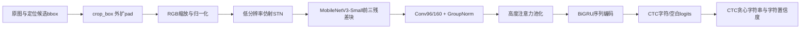
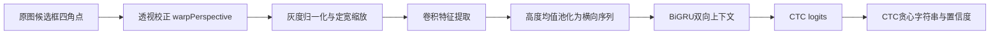

# 第 3 章 识别模型

| 元信息 | 内容 |
|---|---|
| 文档用途 | 《M2 车牌识别详细设计》第 3 章素材 |
| 当前比较 | box_reader_v2→v3、crnn_v2→v4、char_cnn_v2→v3；2026-10-28 已完成训练及独立评测 |
| 运行边界 | 本章记录单模型路线结果；三路组合验收由 03 按当前默认流程负责。新权重未因此成为生产默认模型。 |

## 3.1 识别器职责和协作输入

三种识别器读取同一车牌的不同表示：box 路线直接读取定位器给出的原始矩形框；CRNN 路线读取四角点透视校正后的整牌序列；分割 CNN 路线先切出字符格，再逐字分类并按版式约束组成车牌。检测与识别分开训练，候选身份和模型版本供离线追溯。接口 `read`/`predict_proba` 的计时只覆盖模型原调用，不含原图解码、定位、透视校正、分割或仲裁；它不是整帧 G1 时延。

## 3.2 框直接读：STN + MobileNetV3 前段 + BiGRU + CTC

输入是原图候选框；按 checkpoint 的 `pad_x/pad_y` 用正式 `crop_box` 截取，不用真值四角或外部透视校正。v3 输入为 RGB 192×64，pad=(0.08,0.12)；STN 只看像素，训练期 GT 四角仅提供几何辅助监督。v3 从 v2 续训 20 轮，主学习率 8e-5、STN 学习率 1.6e-5，几何 MSE 权重 1。每轮真实 source 物理读取一次，沿用九组 multiplicity 并追加有限外省真实重放；35% source 另做合成 copy。合成仅替换首字格并同步标签，真实 jitter 若裁掉首字仍保留原扰动。

## 3.3 校正 CRNN：透视归一化 + CNN + BiGRU + CTC

正式接口接收四角校正后的 BGR 裁片：7 位 252×80、8 位 276×80；内部转灰度、缩放至模型输入 160×40 并归一化。CNN 特征沿高度池化为横向序列，BiGRU 后由 CTC 输出字符与 blank。crnn_v4 从 crnn_v2 续训 15 个完整 epoch，学习率 8e-5；固定验证集只用于冻结后报告。训练和推理均使用本项目 CRNN 工厂与对应 checkpoint，不从 box 模型推断结构。

## 3.4 分割 + CNN：字符格分类和规则解码

输入为校正后的 BGR 车牌，分割器输出 `N×32×32 uint8` 字符格。统一 65 类分类头输出各格概率，解码按首位省份、第二位字母及后续槽位约束组成整牌。char_cnn_v3 从 v2 初始化，冻结卷积特征及非省份类别参数，仅训练最终 Linear 的 31 个省份类别行，学习率 0.001、10 轮。头部两张量更新不代表 softmax 后非省份置信度逐项不变；报告分别保留未约束 raw 结果与按位置约束结果。

## 3.5 训练数据、隔离与检查点

三模型沿用经审计的安全 CCPD 训练索引和只读裁片缓存，每轮覆盖 210,564 个真实 source 及 73,697 个确定性合成输入；训练来源覆盖 31 省（藏 1）。真实省份留出 486 张，陕 20 张；留出与旧 box 训练 source 有 52 张交集、与旧 tune 交集为 0，因此它不是相对全部历史权重完全独立的盲测。训练/合成底图按路径与 SHA 排除 testset、golden、devhard、val1000、undecodable 五份保护名单及别名/重复内容，并排除本批 holdout。独立数据隔离审计 20 项通过。

真实样本的物理读取与合成份数分别记录：box 4,211,280 / 1,473,940，CRNN 3,158,460 / 1,105,455，CharCNN 2,105,640 / 736,970。合成只在训练中在线生成，不落盘为新图像集。首字替换裁片由 GT 四角确定首格，限制在 canonical 区间、清理底色后渲染目标字并同步标签；小测试检查首格外像素未变。所有权重均由官方工厂加载并经独立 SHA、张量有限性及参数审计；18 个受保护文件和 13 个既有 manifest 条目保持不变。

省份配额在旧九组 multiplicity 之后追加：每个非皖省每轮最多 5,000 个 draw，每个 source 最多再抽 19 次；因此真实 logical draw 为 997,377。合成目标按 31 省均匀分配，每轮每省 2,377 或 2,378 个，按 real_weight/0.65 加权后约占 logical 权重 35.13%。同一 source 的逻辑重复折叠为权重，每轮真实图只做一次物理 forward；重复份数不等价于独立增强或新增真实图片。

## 3.6 同一定位器下的旧新模型结果

实际评测固定使用 `plate_det_v1` 和同一配置、候选及路线读法；3100 张分母为 val1000 + devhard2100，非皖 261 张来自两 split 的固定 GT 并集（val 45、devhard 216），皖牌 2839 张。每格“旧→新”均为准确率。新旧单模型分开评测，不含三路仲裁或阈值搜索。表中实际列的数值来自六份 safe 报告和两份 actual 报告，独立复算通过。

| 路线 | 省份留出省份字 (n=486) | 省份留出整牌 | 合成省份字 / 整牌 (n=930) | val 省份字 / 整牌 | devhard 省份字 / 整牌 | 非皖261 省份字 / 整牌 | 皖牌2839整牌 | 实际调用 mean / P95 ms (旧→新) |
|---|---:|---:|---:|---:|---:|---:|---:|---:|
| Box | 94.86→97.53% | 94.86→96.71% | 22.90→88.71% / 22.47→86.02% | 99.30→98.80% / 98.30→98.10% | 99.19→98.71% / 95.33→95.00% | 93.10→91.19% / 92.34→90.42% | 96.65→96.51% | 3.963/6.662 → 5.249/8.193 |
| CRNN | 91.36→94.65% | 90.74→93.62% | 59.03→96.88% / 51.94→88.60% | 99.20→99.20% / 96.70→96.80% | 96.76→97.05% / 84.71→88.43% | 82.38→83.52% / 78.93→83.14% | 89.47→91.86% | 3.677/5.952 → 4.852/7.216 |
| CharCNN：GT 首字 | 97.33→95.88% | — | 61.18→82.90% / — | — | — | — | — | — |
| CharCNN：完整分割路线 | 93.42→92.59% | 93.21→92.39% | 41.61→51.18% / 38.49→47.10% | 92.20→92.50% / 91.20→91.30% | 65.81→67.62% / 58.48→58.48% | 78.16→78.16% / 76.25→76.25% | 68.37→68.40% | 4.306/6.642 → 5.343/7.953 |

CharCNN 的 GT 首字裁片结果与完整分割路线使用不同输入，不能混作一条指标：GT 首字留出为 95.88%、合成为 82.90%；完整分割路线的省份字结果分别为 92.59%、51.18%，整牌分别为 92.39%、47.10%。陕留出 n=20 三模型均为 20/20 首字正确。错皖数（val/devhard/非皖261，旧→新）为 Box 6→4 / 4→6 / 10→10，CRNN 6→4 / 14→16 / 20→20，CharCNN 1→1 / 8→14 / 9→15。逐省 n≥20 的数据和所有 subset 分项见 `algorithm/out/receipts/batch12/result-tables.md`。

上表时延为 actual 阶段原方法调用，box/CRNN 为 `read`，CharCNN 为分割路线 `predict_proba` 的 N=7/8 批次；均为 CPU 2 线程、保留冷调用的均值和 nearest-rank P95。CharCNN 单字符 N=1 的 safe GT 面板另测 3,816 次：v2 1.466496/2.1100 ms，v3 1.466034/2.0628 ms。N=1 与整牌分割路线的 N=7/8 批次不可直接互换。

Box 新模型非皖 261 张省份字准确率从 93.10% 降至 91.19%，整牌从 92.34% 降至 90.42%；其 CPU 2 线程 P95 为 8.1933 ms，高于 8 ms 目标。CRNN 新模型真实留出省份字 94.65%，低于 97% 目标。CharCNN GT 留出省份字 95.88%、合成省份字 82.90%，均低于对应目标。CharCNN 非省份位 raw 正确数由 16,465/16,994 降至 16,440/16,994（少 25）；按槽位允许集合约束后两版均为 16,538/16,994，逐类约束准确率不变。

## 3.7 训练产物、成本和验收状态

| 新模型 | 完整轮数 / 最佳轮 | 参数量 | 文件大小 | 温度 / 其他固定参数 | SHA-256 |
|---|---:|---:|---:|---|---|
| box_reader_v3 | 20 / 18 | 544,401 | 2,208,273 B | T=1.166143；192×64；pad .08/.12 | `461c334ca916944f65cda925ce6910f8ccec3e29f2327baef3c02eea8fa00658` |
| crnn_v4 | 15 / 13 | 218,474 | 886,763 B | T=1.086233；输入 160×40 | `af693f4c4f85b224019371248134fb2f055f70ebcce3661a33a0d9ee12bfad23` |
| char_cnn_v3 | 10 / 9 | 680,737 | 2,738,103 B | T=1.0；输入 32×32；只改省份 head 权重/偏置 | `18844d3c1c6cdaf8195f1b406086d13d359524f4baede72090e985988792efbf` |

有效训练历史时间分别为 box 9,450 秒（2.63 h）、CRNN 8,867 秒（2.46 h）、CharCNN 4,423 秒（1.23 h），合计 22,741 秒（6.32 h）；包括逐 epoch CPU 选轮和恢复后的已计入 epoch 活跃时间，不是 GPU kernel 时间，也不是全项投入成本。对应日历跨度合计 27,520 秒（7.64 h），包含暂停与恢复等待。另有废弃 Box 试跑 0.9962 h、CharCNN 失败尝试 0.0120 h，以及未计入上述有效历史的探针和工具准备。CRNN 一次进程失联没有 exit 记录，已观察运行下界 5,033 秒，原因和全部时长未知，故总投入不能由 6.32 h 推称小于 7 h。审计记录 5 次自动恢复；失败试跑和拒绝启动不计作完整训练轮。

训练与六 safe / 两 actual CPU 阶段按单阶段串行完成，阶段退出码均为 0；独立模型审计及最终指标复算均通过，后者只读取 val/devhard 元数据和评测结果，不读取 testset 图像。周期采样过程树 RSS 峰 2,667,008,000 B，专用 GPU 峰 1,020,821,504 B，全机空闲内存最低 422,813,696 B；采样是周期性的，不能排除间隔内瞬时峰。提交前本批 checkout 文件约 278 MB，Git 新对象压缩 payload 另列最终交付审计；不含既有共享裁片缓存、环境和原图。采样树未完整覆盖监督父进程及独立短时工具，不据此宣称所有瞬时总内存都已测到。

本批训练量和模型完整性已完成，但目标并非全部达到：Box 合成总体省份字 88.71%（目标 95%）、非皖准确率下降且 P95 超 8 ms；CRNN 留出总体 94.65%（目标 97%）；CharCNN 留出 95.88%、合成 82.90%（分别低于 97% / 95%）。没有追加训练或改变配方。上述结果不构成新默认切换依据；三路组合及产品侧仲裁评测由 03 使用当前流程另行负责。本批单模型数据与独立审计索引见 `algorithm/out/receipts/batch12/result-tables.json`、`independent-model-audit.json`、`independent-final-eval-audit.json` 和 `cost-resource-audit.json`。
