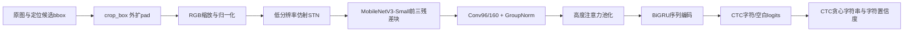
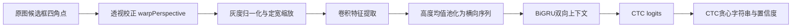
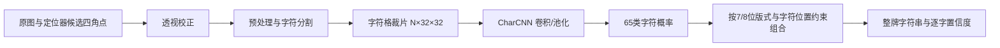

# 第 3 章识别模型：三路整牌读取设计素材

| 元信息 | 内容 |
| --- | --- |
| 文档用途 | 《M2车牌识别详细设计》第3章素材，供架构师合并 |
| 维护范围 | 三条识别路线、训练/评测边界和已复核开发集基线 |
| 当前基线 | box_reader_v2、crnn_v2、char_cnn_v2；第十二批三模型续训与结果待该批冻结后补录 |
| 运行边界 | 当前文档描述模型与离线对照；不表示新权重已接入默认流水线 |

## 3.1 识别器职责和协作输入

三种识别器针对同一车牌的不同表示提供读法：框直接读路线从定位器给出的原始矩形框直接识别，减少对角点校正的依赖；CRNN路线读取四角点透视校正后的整牌序列；分割+CNN路线先把整牌切为字符格，再逐字符分类并按版式规则组合。检测与识别分开训练，三路输出都保留候选身份和模型版本，供上层仲裁及离线追溯。

本章的“read”指一张已准备好的裁片进入识别模型后的推理，不含原图读取、定位、候选融合、透视变换和业务接口耗时。实际系统仍需以端到端G1基准测量整帧延迟。模型文件必须和manifest中的架构、字符表、输入尺寸、pad、SHA及训练数据记录一致；加载时校验元数据，不以文件名猜架构。

## 3.2 框直接读：STN + MobileNetV3前段 + BiGRU + CTC

输入是原图中的候选矩形框和其bbox；读取时按权重记录的`pad_x/pad_y`通过正式`crop_box`从原图截取，不用真值四角、不做外部透视校正。v2的输入为RGB宽×高192×64，ImageNet均值方差归一化，pad=(0.08,0.12)。仿射STN只看像素；训练时GT四角相对当前bbox裁片提供几何辅助监督，推理不接收GT。骨干继承本项目v1相同层的通用ImageNet初始化，不使用车牌专用外部权重；新STN与识别头随机初始化。特征序列由高度注意力压缩后输入单层双向GRU，CTC在横向时间步输出字符序列。

输入契约为BGR `uint8`原始crop，输出是解码字符串、每个输出字符置信度和整牌最小字符置信度；模型返回CTC贪心序列，调用方再按7/8位版式验证合法性。第十二批box_reader_v3从本工位box_reader_v2完整权重续训20轮，主学习率8e-5、STN学习率1.6e-5，沿用v2的几何MSE权重1；真实source每轮一次物理读取，按旧九组multiplicity再追加有限外省真实重放权重，并为35%来源追加合成copy。合成只改GT首字格并同步标签，原始jitter若裁掉首字仍保留原扰动，不为真实分支回退真值框；只有合成copy的首字定位采用GT框。模型温度、正式准确率、整牌回归与CPU时延尚未冻结，详见本章待填项。

## 3.3 校正CRNN：透视归一化 + CNN + BiGRU + CTC

输入来自定位/校正路线的四角点及原图；先以透视变换生成水平整牌，再按字符数对应的标准尺寸裁片。当前CRNN的训练/推理图像为灰度，缩放到高40像素、宽160像素的输入张量；正式读取接口接受四角校正后的BGR 252×80（7位）或276×80（8位）裁片，模型内部灰度化、缩放并按[-1,1]归一化。CNN提取空间特征，沿高度自适应平均得到宽度序列，BiGRU产生上下文表示，线性层输出65类字符加CTC blank。无需字符框逐字标注，整牌字符串即可计算CTC损失。

CRNNv2为本地历史权重基线；第十二批crnn_v4从crnn_v2权重在GT四角校正裁片续训15个完整epoch，学习率8e-5。安全训练source按省份及既有组分层，并在线生成目标省份首字copy；数据来源审计同框读路线。固定val/devhard只作模型冻结后报告。模型输入尺寸、温度与state_dict契约不得从box reader推断，工厂需按checkpoint architecture/version校验。正式新模型识别指标尚未出。

## 3.4 分割 + CNN：字符格分类和规则解码

输入为透视校正后的BGR整牌及版式/颜色信息，字符分割模块输出`N×32×32 uint8`灰度字符图，N随7/8位布局而定。CharCNN内部为1→32→32→64→64→128卷积块，池化后展平，2048→256→65全连接分类；每个字符格输出65类概率。其后按省份、字母、数字/字母混合槽位限制与长度规则组成整牌，位置约束只能剔除非法类，不使用测试标签。

char_cnn_v3保留65类统一分类头；从char_cnn_v2初始化并冻结卷积特征和非省份类别参数，只更新最终Linear中31个省份类别的行，学习率0.001训练10轮。这样可让非省份类别的原始logits逐项保持，但由于省份行变化，softmax归一化后的非省份置信度仍会变化，须用正式整牌评测确认其余字符/整牌不退步。省份分类真实样本取安全训练源（含皖）的首字裁片，合成字符在线生成、不写入运行时包。参数/模型大小与每字符、整牌指标等待冻结结果。

## 3.5 训练样本、保护规则与省份均衡

训练数据继承第十一批安全CCPD索引和只读扩框裁片缓存。本批训练索引含210,564个真实source，覆盖31省（藏1）。省份留出486张，其中陕20；与旧box_reader_v2训练source有52张交集，因此它只证明本批训练/调参隔离，不是相对所有历史模型完全独立的盲测；与旧tune交集为0。任何训练或合成底图仍按规范路径和内容SHA排除testset、golden、devhard、val1000、undecodable五份保护名单及跨名单别名/重复字节，并排除本批holdout。独立数据审计20项均通过。共享缓存只读，不生成新的全量图片缓存或外部数据集。训练以单线程、最多一块的CPU预取重叠GPU计算；所有原图CUDA解码及超缓存回退留在主线程，渲染以锁保护共享字体对象，DataLoader进程数为0。温度拟合和选模使用派单指定安全调参资料。

留出按固定种子逐省取min(20,该省候选数的30%)，共486张，陕20；藏等不足5张省份只由合成集评价。与旧box reader训练池重叠52张、旧tune重叠0，故留出不是跨历史权重的独立盲测。真实source保留第十一批9组multiplicity基础；对每个非皖省份再追加每轮最多5,000个省份draw，每个source最多增加19份。真实source仍每轮恰好一次物理forward。按目标均匀补入31类省份合成copy，首轮共73,697份、每省2,377或2,378；合成权重取real_weight/0.65，首轮logical合成占比约35.13%，真实logical draw为997,377。省份配额是叠加在九组基础上的额外抽样，不代表将整轮限制为20次。训练日志同时记录真实unique覆盖、物理forward数、真实/合成logical数和逐省配额。

首字替换只作用于训练样本：从真实裁片按GT四角及槽位布局确定首字格，以方向灰度对比和Otsu生成笔画及抗锯齿掩码，再用未遮罩的左右边界/同行像素插值重建底色，清除原字后渲染目标省份字并同步改标签；首格范围限制为canonical横向0.012–0.145，字形按宽高分别匹配源格，逆透视贴回只改首格多边形内像素；小测试确认第二位及格外像素不变。匹配蓝/绿/黄底色、字色、模糊与透视。只有合成copy使用GT框回退来保证首字格可见；真实jitter若裁掉首字，照常保留，不改成GT框。固定种子合成评测按31省各30张确定性生成，不保存图像。内部glyph mask可在进程中缓存以减少重复渲染，但不落盘为图片缓存。字体文件只使用本机现有字体且不入库。

## 3.6 已复核开发集结果与测量边界

下表是第十一批及架构师第十二批在旧模型上的已复核基线，作用是判断第十二批更新是否回归。它们的模型、定位器、回退规则及业务门禁不同，不能拼成一个排行榜。第十二批三个新checkpoint冻结后，应在表后新增同口径行，并对非皖261张、逐省留出与合成31省×30张单列首字准确、整牌准确及错为“皖”数量。

| 数据/路线/口径 | 整牌结果 | 关键子集结果 | 来源与限定 |
|---|---:|---|---|
| box_reader_v2，val1000实际Top-3候选合法读法 | 974/1000（97.40%） | green 478/500（95.60%） | 第十一批冻结评测；候选为corner_net_v1+传统定位，read CPU2线程mean 4.1786ms、P95 5.6259ms；非整帧时延 |
| box_reader_v2，devhard_v1实际Top-3 | 1792/2100（85.33%） | 最暗48/51（94.12%）；tilt+rotate 527/600（87.83%） | 第十一批固定开发集，取合法读法最高最小字符置信度 |
| box_reader_v2，safe GT tune | 2316/2400（96.50%） | tilt 293/300（97.67%）；8位green 285/300（95.00%） | 参与选轮，不是盲测 |
| 三路011+D0_M（box_reader_v1+旧corner_net_v1定位），val/devhard | val 960/1000（96.00%）；hard 1605/2100（76.43%） | green 465/500（93.00%）；dark 40/51（78.43%）；tilt+rotate 481/600（80.17%） | 03第十二批旧模型冻结trace回放；自动通过2053，val 904/908=99.56%、hard1140/1145=99.56%；其结果经业务错误门禁投影 |
| crnn_v4、char_cnn_v3、box_reader_v3 | 未测：正式CPU评测尚未完成 | 逐省首字、整牌及误判“皖”待评测 | 训练配方已确定；不得用训练目标推作评测结果 |

CPU时延采用本地CPU、2线程、固定裁片和完整调用次数报告，保留冷调用及离群值；BoxReader第十一批mean/P95是该接口实测值。整帧G1另含图像解码、定位、透视校正、分割和仲裁，不能由单路线read时延相加/替代。CRNNv2与CharCNN现有历史时延若非本批相同机器、线程、调用计时定义，不与BoxReader做严格速度比较；第十二批各新工厂冻结后再补表。

## 3.7 本批验收结果待填项

第十二批训练配方已定，但正式CPU评测和完整三路复测仍未出。本章待补：新模型checkpoint SHA/参数量/文件大小/实际完成epoch；逐省真实留出与固定合成31省结果；调参、val1000/devhard各子集、非皖261张；三路组合val、green、hard、dark、tilt+rotate、自动通过精度及测试集组成折算；box reader CPU2线程mean/P95。未测项明确记“未测”，不将训练目标或论文结果写作实测。
